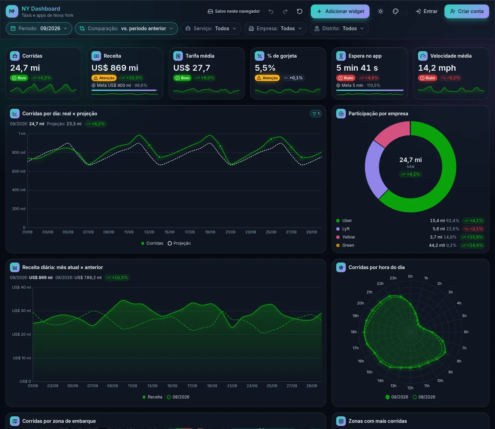
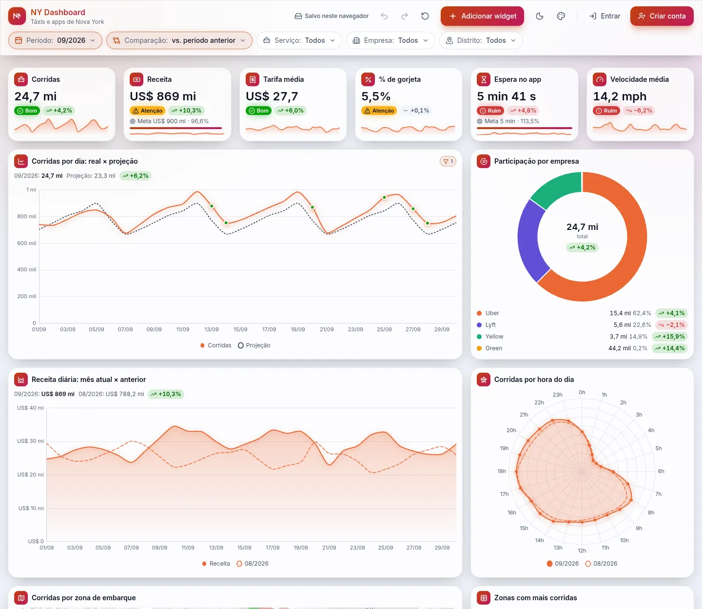
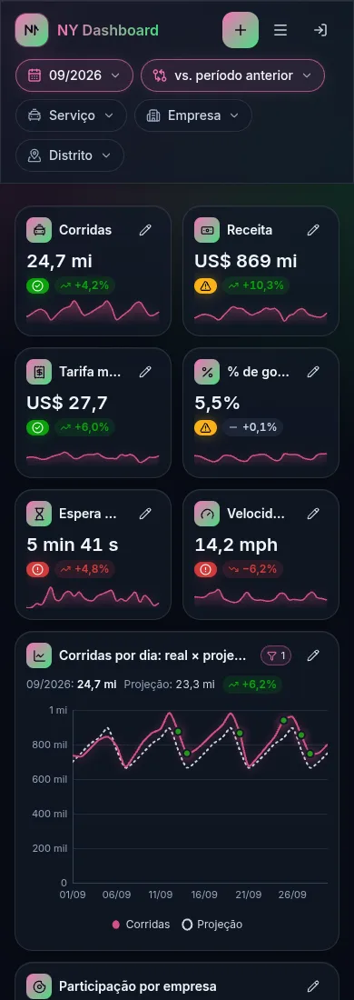
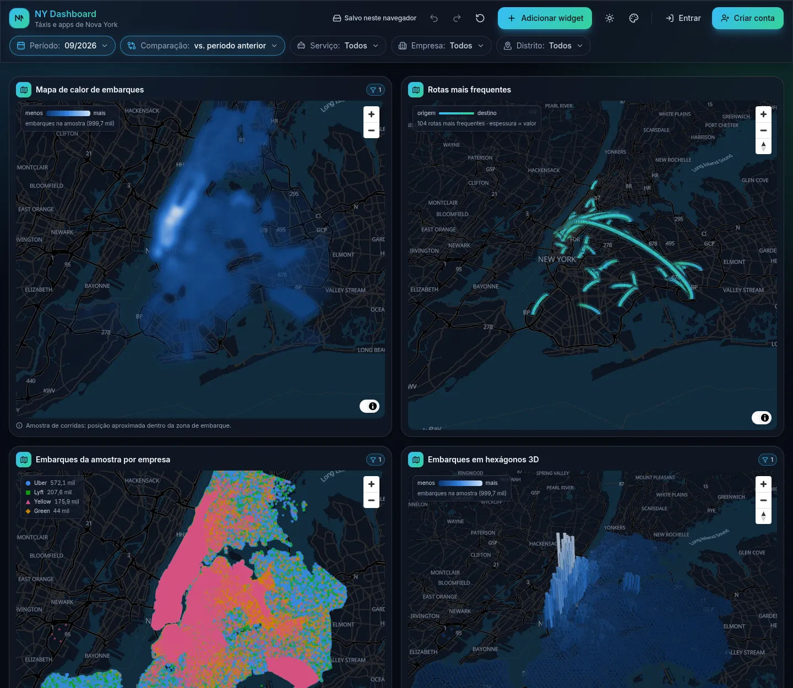

# ny-dashboard

[](https://github.com/BrunoNC22/ny-dashboard/actions/workflows/ci.yml)

Repositório de demonstração de um **dashboard personalizável, rápido e bonito**, com dados reais de **24 meses de corridas de táxi e de apps (Uber/Lyft) em Nova York** (NYC TLC, out/2024 → set/2026).

- **Front:** React 19 + TypeScript, **react-grid-layout** (você monta o dashboard), **Chart.js** (um único arquivo de estilo que segue o tema), **Tailwind CSS v4** (tokens de cor), **MapLibre + deck.gl** (mapas na GPU).
- **Back:** Express 5 em MVC, **Prisma 7 + PostgreSQL 18**, autenticação simples por usuário e senha.
- **Dados:** ETL com DuckDB → snapshot agregado versionado → seed no Postgres. Projeção Holt-Winters para "esperado × real".



| Tema claro (paleta Sunset)                    | Celular (layout próprio)                                      |
| --------------------------------------------- | ------------------------------------------------------------- |
|  |  |



## O que dá para fazer

- **Montar o dashboard:** adicionar widgets a partir de uma **galeria de 33 modelos**, editar num modal com **prévia ao vivo**, mover (pelo cabeçalho), redimensionar (pelo canto), duplicar e remover. Ctrl+Z / Ctrl+Shift+Z desfazem e refazem; "voltar ao padrão" restaura o modelo inicial.
- **14 tipos de widget:**
  - linha, área, barras e barras empilhadas;
  - rosca, pizza, radar, área polar e ranking;
  - dispersão e bolhas sobre a amostra de corridas;
  - KPI com status bom/atenção/ruim;
  - tabela;
  - mapa (zonas, bolhas, calor, rotas, pontos, hexágonos 3D).
- **Filtros globais** (período, serviço, empresa, distrito), que cada widget pode sobrescrever, e **comparações**: período anterior, mesmo período do ano anterior, intervalo personalizado e **projeção × real**. No mapa, a comparação pinta as zonas pela variação.
- **Desktop e celular com layouts independentes**: o conjunto de widgets é o mesmo, mas posição e tamanho são separados.
- **Salvo na conta, em qualquer dispositivo:** autosave a cada edição. Entrando em outro navegador, aparece o mesmo dashboard, tema e paleta. Visitantes usam o dashboard no próprio navegador e podem importá-lo ao criar uma conta.
- **Tema claro/escuro e 6 paletas** (Aurora, Sunset, Ocean, Neon, Forest, Mono). As cores dos gráficos foram validadas para daltonismo e contraste.

## Rodar com Docker

Requisito: Docker com Compose v2.

```sh
git clone https://github.com/BrunoNC22/ny-dashboard.git
cd ny-dashboard
docker compose up --build
```

Abra http://localhost:8080 e use o dashboard como visitante ou entre com **`demo` / `demo1234`**.

- Na primeira vez, a api aplica as migrations e carrega o snapshot de dados no Postgres (~2 min; acompanhe com `docker compose logs -f api`). Nas próximas, ela detecta que o snapshot já está no banco e sobe em segundos.
- Nada precisa ser configurado. Sem `JWT_SECRET` (ou com o valor de exemplo), a api gera um segredo aleatório e o guarda no volume `api-secrets`.

| Serviço | Porta                  | O que é                                               |
| ------- | ---------------------- | ----------------------------------------------------- |
| `web`   | `8080` (WEB_PORT)      | nginx com o app e o proxy de `/api`                   |
| `api`   | interna (`3000`)       | Express; acessível pelo nginx em `/api`               |
| `db`    | `5432` (POSTGRES_PORT) | PostgreSQL 18, publicado para o desenvolvimento local |

Variáveis opcionais (no ambiente ou num `.env`; veja o [`.env.example`](./.env.example)): `WEB_PORT`, `POSTGRES_PORT`, `POSTGRES_USER`/`POSTGRES_PASSWORD`/`POSTGRES_DB`, `JWT_SECRET`, `JWT_EXPIRES_IN`, `COOKIE_SECURE` (use `true` atrás de HTTPS), `LOG_LEVEL` e `SEED_FLAGS` (`--force` recarrega o snapshot).

Se a porta 8080 estiver ocupada: `WEB_PORT=8090 docker compose up --build`. Para começar do zero: `docker compose down -v` (apaga o banco, as contas e os dashboards salvos).

## Desenvolvimento

Requisitos: Node 24, pnpm (a versão vem do `packageManager`; `corepack enable` resolve) e Docker.

```sh
cp .env.example .env              # variáveis locais (o git ignora este arquivo)
pnpm install                      # também gera o Prisma Client (postinstall)
docker compose up -d db           # Postgres 18 em localhost:5432
pnpm --filter @ny-dashboard/api db:migrate   # aplica as migrations
pnpm --filter @ny-dashboard/api db:seed      # carrega o snapshot (~1,5 min; só na primeira vez)
pnpm dev                          # API (:3000) + web (http://localhost:5173, proxy /api → API)
```

Em desenvolvimento, a página `/_ds` mostra o design system (componentes, estilos dos gráficos e do mapa), e `?theme=light&palette=ocean` na URL troca a aparência.

### Testes

| Comando                                              | O que roda                                                                                                                                                                          |
| ---------------------------------------------------- | ----------------------------------------------------------------------------------------------------------------------------------------------------------------------------------- |
| `pnpm lint` · `pnpm format:check` · `pnpm typecheck` | ESLint (type-checked), Prettier e TypeScript nos três pacotes                                                                                                                       |
| `pnpm test`                                          | testes de unidade (Vitest) de `shared`, `api` e `web`                                                                                                                               |
| `pnpm --filter @ny-dashboard/api test:integration`   | API contra um Postgres real, num banco `<DATABASE>_test` recriado a cada execução (precisa do `db` rodando)                                                                         |
| `pnpm e2e`                                           | Playwright contra o stack do `docker compose` (`E2E_BASE_URL`, padrão `http://localhost:8080`). Na primeira vez: `pnpm --filter @ny-dashboard/web exec playwright install chromium` |

O CI (GitHub Actions) roda tudo isso a cada push na `main`, inclusive o build das imagens e os E2E.

## Arquitetura

```
api/      Express 5 (routes → controllers → services → models; views = serializers)
          Prisma 7 + PostgreSQL · ETL DuckDB (api/etl) · snapshot em api/data · seed idempotente
web/      React 19 + Vite · react-grid-layout · Chart.js (src/charts/chartTheme.ts)
          MapLibre + deck.gl (src/map) · Zustand + TanStack Query · Tailwind v4 (tokens em src/styles)
shared/   contratos zod da API, catálogo de métricas, dashboard padrão, períodos
```

- O `shared` é usado pelos dois lados, então front e API validam os mesmos contratos e calculam as métricas do mesmo jeito: médias e percentuais saem sempre das somas, nunca de média de médias.
- A API serve **dados agregados** (diário × zona, hora, rotas por mês) e uma **amostra de 1 milhão de corridas** para os gráficos de dispersão e os mapas de pontos.
- A projeção Holt-Winters (sazonalidade semanal, com backtest mês a mês) é calculada no seed.

Todas as decisões do projeto, com o porquê de cada uma, estão em **[CLAUDE.md](./CLAUDE.md)**.

## Desempenho com muitos dados

O projeto é também uma vitrine de limites, de propósito:

- **A API manda todos os pontos pedidos**, sem reduzir no servidor. Respostas grandes vão em formato colunar e com gzip.
- **Séries longas** (por exemplo, corridas por hora em 24 meses, ~17,5 mil pontos por série) usam a **decimação LTTB** do Chart.js, sem animação e com `parsing: false`.
- **Dispersão com 1 milhão de pontos** no Chart.js: ~3,7 MB com gzip, e o gráfico **fica lento de propósito**. O widget mostra o tempo de desenho e desliga o hover acima de 100 mil pontos.
- **Mapas com 1 milhão de pontos** no deck.gl (GPU): calor, pontos com um ícone por empresa e hexágonos 3D.
- Mapas e gráficos de amostra são carregados sob demanda. O bundle inicial tem ~150 kB com gzip.

## Atualizar os dados

A TLC publica com cerca de 2 meses de atraso. A atualização é manual:

```sh
cd api
pnpm etl --from 2026-10 --to 2026-10   # baixa e agrega só o mês novo (um arquivo por vez, com DuckDB)
pnpm etl:snapshot                      # exporta os 24 meses mais recentes para api/data/snapshot (+ manifest.json)
```

Isso usa o `api/etl/.cache/etl.duckdb` local, que guarda os meses já processados. Num clone novo, rode o período completo (`pnpm etl --from 2024-11 --to 2026-10`: ~14 GB baixados aos poucos, ~16 min).

Atualize `DATA_COVERAGE` em `shared/src/defaults/coverage.ts` (um teste compara com o manifest) e commite. No próximo `docker compose up`, a api percebe que o snapshot mudou e recarrega os dados (contas e dashboards são preservados). Detalhes, regras de limpeza e o schema normalizado estão em [`api/etl/README.md`](./api/etl/README.md).

## Atribuições

- Dados: [NYC Taxi & Limousine Commission — TLC Trip Record Data](https://www.nyc.gov/site/tlc/about/tlc-trip-record-data.page)
- Mapa de fundo: [OpenFreeMap](https://openfreemap.org) / © [OpenStreetMap contributors](https://www.openstreetmap.org/copyright)
- As posições das corridas da amostra são **aproximadas**: a TLC publica só a zona de embarque, então cada corrida recebe um ponto aleatório (determinístico) dentro da sua zona.

## Licença

[MIT](./LICENSE)
